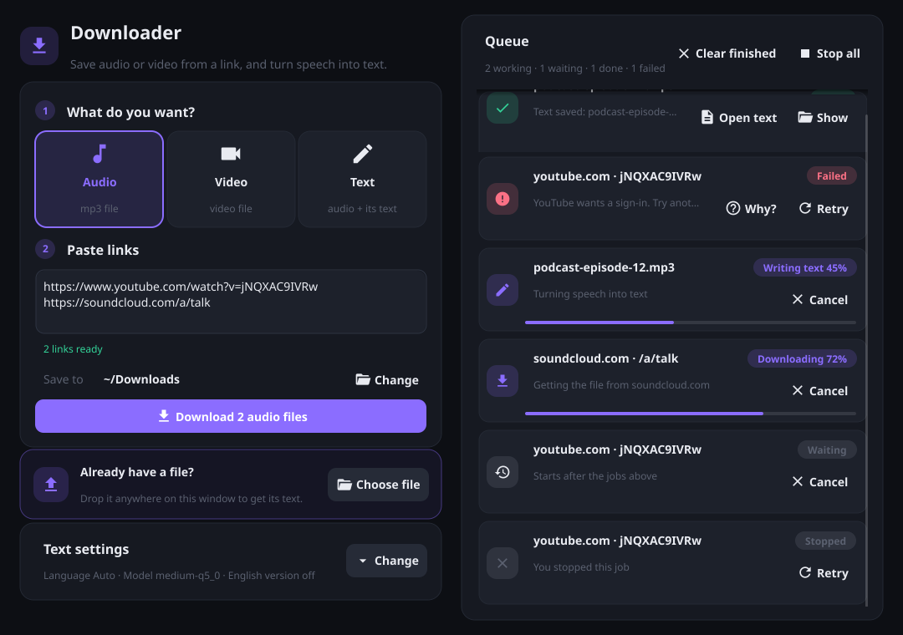
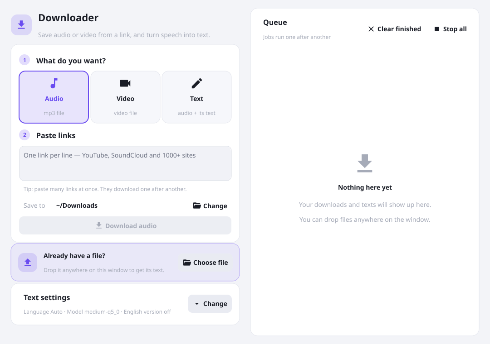

# Downloader

[](https://github.com/mohsenm4/downloader/actions/workflows/ci.yml)
[](https://github.com/mohsenm4/downloader/releases/latest)
[](LICENSE)

A small macOS app to save audio or video from a link, and turn speech into text.



## Download

Get the latest **Downloader-…-macos-universal.zip** from [Releases](https://github.com/mohsenm4/downloader/releases/latest). It works on Apple Silicon and Intel Macs.

The app is not notarized by Apple, so macOS blocks it the first time. Open it once, then click **Open Anyway** in **System Settings → Privacy & Security**. Or run:

```sh
xattr -dr com.apple.quarantine /Applications/Downloader.app
```

Then install the tools and a model, as below.

## Features

- **Audio, Video or Text** from a link. Paste many links, one per line.
- **Text from your own files**: drop audio or video anywhere on the window.
- **Queue**: jobs run one after another. Each job shows its progress and can be stopped or retried.
- **Speech to text** with [whisper.cpp](https://github.com/ggml-org/whisper.cpp), on your Mac, offline.
  - Language: Auto, Persian or English
  - Optional English translation (`.en.txt`)
  - Output next to the media file: `.txt` and `.srt` (subtitles with times)
- **Clear errors**: common yt-dlp errors are shown in plain words. "Why?" shows the full message.
- Light and dark theme (follows macOS).
- Remembers your last choices.

## Requirements

- macOS (Apple Silicon or Intel)
- Go 1.25+
- [Homebrew](https://brew.sh)

Install the tools the app runs, and the Fyne packaging tool:

```sh
make tools
# same as:
brew install yt-dlp ffmpeg whisper-cpp
go install fyne.io/tools/cmd/fyne@latest
```

If a tool is missing, the app shows a banner with the install command.

### Whisper model

The app reads models from:

```
~/Library/Application Support/Downloader/models/
```

Download a `ggml-*.bin` file from [huggingface.co/ggerganov/whisper.cpp](https://huggingface.co/ggerganov/whisper.cpp/tree/main) and put it there. For example:

```sh
mkdir -p ~/Library/Application\ Support/Downloader/models
curl -L -o ~/Library/Application\ Support/Downloader/models/ggml-medium-q5_0.bin \
  https://huggingface.co/ggerganov/whisper.cpp/resolve/main/ggml-medium-q5_0.bin
```

Bigger models are more accurate but slower. `medium` is a good balance for Persian.
In the app, the folder button next to **Model** opens this folder, and the refresh button reloads the list.

## Build and run

```sh
make run     # run from source
make app     # build cmd/app/Downloader.app
make test    # tests
make race    # tests with the race detector
make release VERSION=1.0.0   # universal app zip in ./dist
```

### Releases

Push a tag and GitHub Actions builds the universal app and publishes the release:

```sh
git tag v1.0.0
git push origin v1.0.0
```

Update [CHANGELOG.md](CHANGELOG.md) before tagging.

## How it works

```
cmd/app                  main: wiring (dependency injection)
internal/domain          plain types: Job, Result, options
internal/usecase         the logic: validate, download then transcribe, the queue
internal/infrastructure
  runner                 runs a program, reads its output line by line, kills it (and its children) on cancel
  ytdlp                  download with yt-dlp, read its progress
  whisper                ffmpeg -> 16 kHz WAV -> whisper-cli, read its progress
  macos                  open files and show them in Finder
internal/config          PATH fix for apps opened from the Dock, models folder, tool check
internal/interface/ui    Fyne UI: theme, cards, queue rows
```

- Apps opened from the Dock get a short `PATH`, so `config.FixPath` adds `/opt/homebrew/bin` and `/usr/local/bin`.
- Each program runs in its own process group. Stop, or closing the window, kills yt-dlp together with the ffmpeg it started.
- In **Audio** mode yt-dlp downloads only the audio stream (`-f wa/w`), so less data is used.
- Links from a playlist download only that one video (`--no-playlist`).

## Screenshots

`make shots` draws the window to `docs/screenshots/` with Fyne's test renderer, without opening the app.



## Notes

- Some sites block requests from VPN servers or some countries. The error message says so; try another server.
- Only download content you have the right to download.

## License

[MIT](LICENSE)
